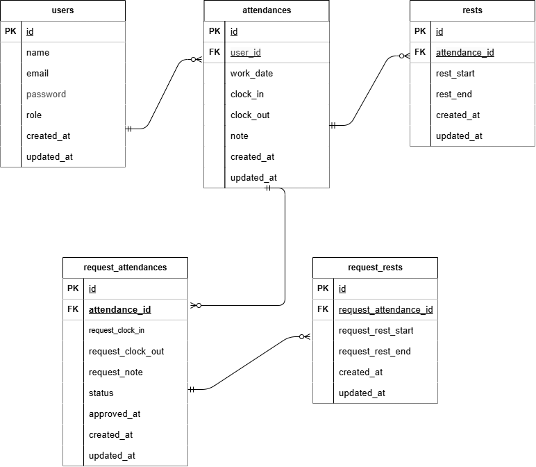

# coachtech 勤怠管理アプリ

## 概要

ある企業が開発した独自の勤怠管理アプリ  
下記の機能・ページを実装

- 会員登録画面（一般ユーザー）
- ログイン画面（一般ユーザー）
- 勤怠登録画面（一般ユーザー）
- 勤怠一覧画面（一般ユーザー）
- 勤怠詳細画面（一般ユーザー）
- 申請一覧画面（一般ユーザー）
- ログイン画面（管理者）
- 勤怠一覧画面（管理者）
- 勤怠詳細画面（管理者）
- スタッフ一覧画面（管理者）
- スタッフ別勤怠一覧画面（管理者）
- 申請一覧画面（管理者）
- 修正申請承認画面（管理者）
- マイ勤怠レポート画面（一般ユーザー）（仮）

## ER図



## 環境構築

```
1. リポジトリをクローン
   git clone git@github.com:aki-sky/attendance-app.git

2. .envファイルの準備
   cp .env.example .env

.envファイルの設定を下記に変更
   DB_CONNECTION=mysql
   DB_HOST=mysql
   DB_PORT=3306
   DB_DATABASE=laravel
   DB_USERNAME=sail
   DB_PASSWORD=password

3. パッケージのインストール

   docker run --rm \
   -u "$(id -u):$(id -g)" \
   -v "$(pwd):/var/www/html" \
   -w /var/www/html \
   laravelsail/php82-composer:latest \
   composer install

4. Laravel Sailの起動
   ./vendor/bin/sail up -d

5. アプリケーションキーの作成
   sail artisan key:generate

6. データベースのマイグレーションとシーディング

   sail artisan migrate:fresh --seed

7. フロントエンドのビルド
   sail npm install
   sail npm run dev
```

## テスト実行

```
sail artisan test
```

## テストユーザーのメールアドレスとパスワード

- ユーザー1（一般）: user1@example.com / password
- ユーザー2（一般）: user2@example.com / password
- ユーザー3（管理者）: user3@example.com / password

## APIエンドポイント一覧

| メソッド | パス                                          | 概要           |
| -------- | --------------------------------------------- | -------------- |
| GET      | /api/v1/attendance-records                    | 勤怠一覧を取得 |
| GET      | /api/v1/attendance-records/{attendanceRecord} | 勤怠詳細を取得 |
| POST     | /api/v1/attendance-records                    | 勤怠を新規登録 |
| PUT      | /api/v1/attendance-records/{attendanceRecord} | 勤怠を更新     |
| DELETE   | /api/v1/attendance-records/{attendanceRecord} | 勤怠を削除     |

## Bladeファイルの変更

管理者の承認ページで空の休憩が表示されてしまう。  
admin-application-detail.bladeの49行目からの下記部分は不要と考え削除。

```
{{-- Figma に合わせ、末尾に空の休憩スロットを1つ表示 --}}

<div class="applied-form__group">
<label class="applied-form__header">{{ $application->proposalBreaks->count() === 0 ? '休憩' : '休憩' . ($application->proposalBreaks->count() + 1) }}</label>
<div class="applied-form__input-group">
<input class="applied-form__input readonly" type="text" value="" readonly>
<p>〜</p>
<input class="applied-form__input readonly" type="text" value="" readonly>
</div>
</div>
```

## 使用技術

- PHP 8.2
- Laravel 10.x
- MySQL
- Docker / Laravel Sail
- Tailwind CSS

## 開発環境URL

スタッフ用会員登録画面
http://localhost/register

スタッフ用ログイン画面
http://localhost/login

スタッフ用勤怠登録画面
http://localhost/attendance

管理者用ログイン画面
http://localhost/admin/login

管理者用勤怠一覧画面
http://localhost/admin/attendance/list

## 作成者

松本旺子
